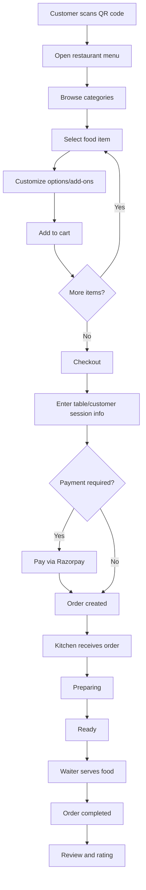
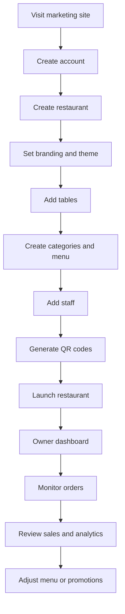
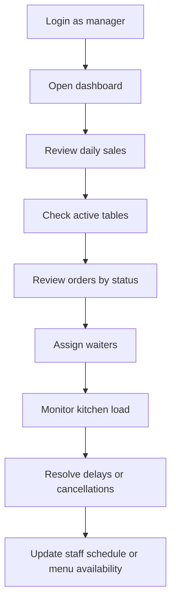
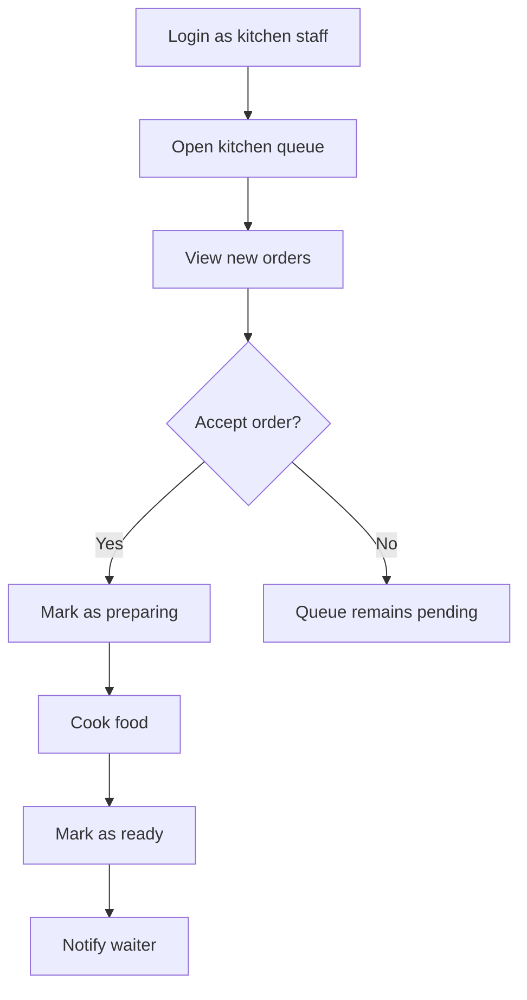
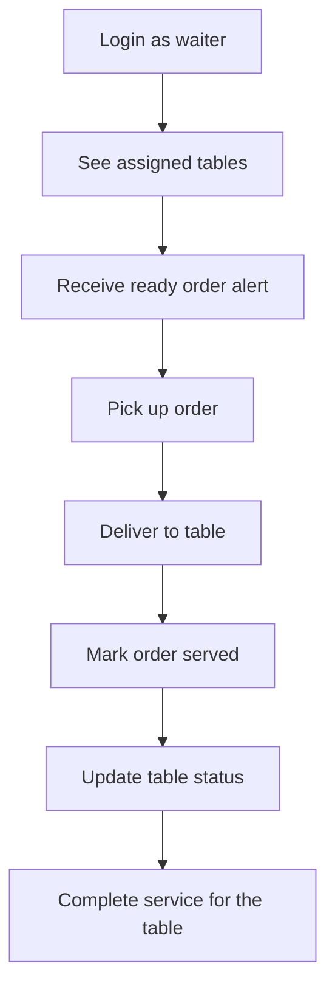
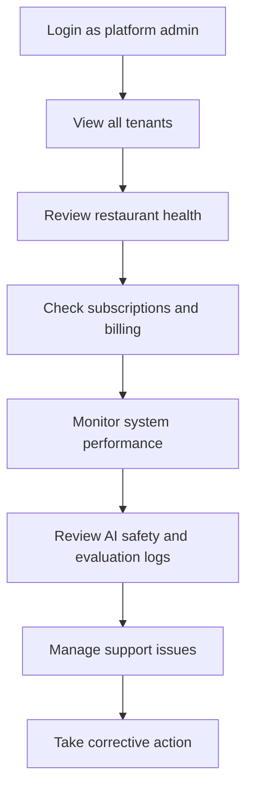
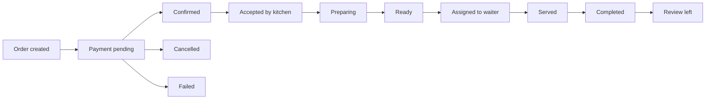
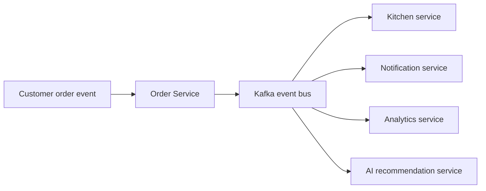

# DineFlow End-to-End User Flows

This document defines the main user journeys for every role in the application.

## 1. Customer flow

## 2. Restaurant owner flow

## 3. Restaurant manager flow

## 4. Kitchen staff flow

## 5. Waiter flow

## 6. Platform admin flow

## 7. End-to-end order lifecycle

## 8. System event flow

This event model is the backbone for real-time UI updates and operational visibility.
